# 🏝️ NexIsland

**Next-Gen Dynamic Island for Windows 10/11 & Android with Deep AI Agent Integration**

 

### 🖥️ Preview App Versi Windows

  

  

  

---

## 📋 Table Version & Release Notes

| Version | Release Date | Platform | Status | Highlights & Changes |
| :---: | :---: | :---: | :---: | :--- |
| **v0.5.6** | **Oct 2026** | **Windows, Android** | **Latest Stable** | • **Official NexIsland Rebranding & New Identity**: Resmi menjadi **NexIsland** dengan Author **Snzy09**. • **Brand New Futuristic App Icon**: Ikon baru modern dengan perpaduan Dynamic Island obsidian capsule, neon cyan-violet glowing rim, dan monogram futuristik di Windows (.ico, multi-size PNG) dan Android (adaptive launcher). • **Mobile Live Task Popup & Direct Prompt Dispatch**: Deteksi realtime tugas Antigravity, VS Code, Cursor, & Claude Code di Dynamic Island Android, tap-to-open session screen interaktif, dan prompt composer langsung kirim instruksi ke aplikasi di PC. • **Antigravity AgentAPI Fix & Auto-Fallback**: Memperbaiki parsing JSON `newConversation`, caching metadata in-memory, dan fallback otomatis ke `new-conversation` jika sesi berakhir. • **Unified Modern Installers**: Tersedia dalam format installer lengkap Windows Setup (.exe) dan Android APK release siap pasang. |
| **v0.5.5** | **Oct 2026** | **Windows, Android** | **Stable** | • **Visual & Audio Notch Experience**: Live bouncing 4-bar equalizer visualizer di sisi kanan compact notch, lirik mini berjalan (*running lyrics*) tersinkronisasi realtime di notch, serta gesture scroll mouse wheel di atas notch untuk atur Volume & Kecerahan Layar (*Brightness*) dengan HUD toast glassmorphism. • **Spotify Player UI Overhaul**: Menghapus overlap titik dot pagination yang menabrak slider volume dan membersihkan tata letak card player. • **Privacy Dots (Webcam & Mic Active + Global Mute)**: Indikator titik hijau (kamera/webcam) & oranye (mikrofon) saat aplikasi aktif menangkap video/audio, deteksi nama aplikasi (Chrome, Zoom, OBS, Teams) via Windows ConsentStore, dan tombol 1-klik Mute Mic global di notch. • **Live Download Progress Notch**: Pantau unduhan file browser realtime (Chrome, Edge, Firefox, Brave) dengan visualizer kecepatan download (`2.4 MB/s · 45%`), progress ring melingkar, dan notifikasi perayaan otomatis `✓ Unduhan Selesai`. • **Laptop Battery Charging & Low Battery Alert**: Animasi petir hijau bercahaya saat charger dicolokkan (`Mengisi Daya · {level}%`) dengan auto-popup 5 detik, serta notifikasi peringatan berkedip halus saat baterai $\le 20\%$ (`Baterai Lemah`). • **Bluetooth Notch Banner & Popup**: Deteksi otomatis perangkat Bluetooth (Classic & BLE seperti TWS, Earbuds, Headphones) via WinRT, battery ring visualizer, audio glow indicator, serta popup hold 5 detik. • **Redesigned TodoList Card**: Circular SVG Progress Ring (54px), kalkulasi kemajuan tugas realtime, status cerdas (*Remaining Tasks* / *All Done! 🎉*), tombol navigasi `<` `>` vertikal seimbang di tengah, dan layout bebas pemotongan/clipping. • **Optimasi RAM & Performa Ekstrem**: V8 heap cap 128MB, Win32 Working Set Trimming otomatis saat idle/hidden, cursor poll throttling 30Hz, dan Mochi RAF throttling saat bot tidak terlihat. • **New Mascot App Logo**: Identitas visual maskot baru di seluruh icon desktop, tray, & installer. • **Pomodoro Focus Timer**: Mode timer fokus 25m & istirahat 5m dengan countdown ring, controls, dan navigasi carousel. • **Logic Chrome auto-minimize saat tab $\ge 3$**: Otomatis minimize ke slim capsule bar jika tab $\ge 3$; tetap standby jika $\le 2$ tab. • **Integrasi Google Antigravity**: Kirim prompt langsung ke session aktif Antigravity dari PC atau HP via `/antigravity` & `/agy`. • **Online MCP Library**: Hub & installer tool MCP daring. |
| **v0.5.0** | Oct 2026 | Windows | Stable | Penambahan Dynamic Island format Vivo Y28, Spotify widget, Phone Link v2, charging status banner. |
| **v0.4.0** | Sep 2026 | macOS, Windows | Legacy | Integrasi Flow Dictation, Parakeet speech-to-text offline, audio call recorder. |
| **v0.2.0** | Aug 2026 | Android, Windows | Legacy | Inisiasi Phone Link TLS server dan aplikasi Android pendamping. |

---

## 🛠️ Tech Stack

```mermaid
flowchart LR
    subgraph Frontend["🎨 Frontend Layer"]
        TS["TypeScript & HTML5"]
        Vite["Vite 6 Bundler"]
        CSS["Modern CSS Transitions"]
        Canvas["HTML5 Canvas Mochi Engine"]
    end

    subgraph Core["⚡ Desktop Core (Tauri v2 + Rust)"]
        Tauri["Tauri 2 Runtime"]
        Win32["Win32 API & UI Automation"]
        WinRT["WinRT Bluetooth Classic & BLE"]
        MediaSessions["Windows Media Transports"]
        AgentAPI["Antigravity Agent API Bridge"]
    end

    subgraph Mobile["📱 Mobile Layer (Android)"]
        Kotlin["Kotlin & Jetpack Compose"]
        PhoneLink["TLS WebSocket Client"]
        AlarmMgr["Android AlarmManager"]
    end

    Frontend <--> Core
    Core <--> Mobile
```

- **Core & Runtime**: [Rust 2021](https://www.rust-lang.org/) + [Tauri v2](https://tauri.app/) (Arsitektur native ultra-ringan dengan V8 heap cap dan working set memory trimmer).
- **Frontend**: TypeScript, Vite 6, HTML5 Canvas Rendering Engine (60 FPS smooth physics).
- **Windows Integration**: Windows Runtime (WinRT) Bluetooth & BLE Device Information, Windows UI Automation (COM), Windows System Media Transport Controls (SMTC), Direct Win32 Window Positioning.
- **Android App**: Kotlin, Jetpack Compose, Android Foreground Service, Coroutines, OkHttp TLS.
- **AI & Protocol**: Google Antigravity Language Server Native CLI Protocol, Model Context Protocol (MCP), WebSocket Secure (WSS).

---

## 🌟 Main Features

### 1. 🏝️ Dynamic Island Presisi Vivo Y28
- Desain notch dinamis dengan kalibrasi rasio layar smartphone Vivo Y28 (tinggi 165.7 mm $\times$ lebar 76 mm).
- Penempatan cutout kamera depan simetris dengan jarak 0.5 cm dari bezel atas.
- Transisi fluida antara mode **Hidden (Slim Capsule)**, **Compact**, dan **Expanded**.

### 2. 🎧 Bluetooth Connected Banner & Popup Notification
- Deteksi otomatis perangkat Bluetooth yang terhubung (Bluetooth Classic & Bluetooth Low Energy seperti AirPods, TWS Earbuds, Headphones, Headset, dan Smartphone).
- Menampilkan notch banner khusus Bluetooth (340 $\times$ 50 px) dengan:
  - **Battery Ring Progress**: Indikator persentase daya baterai melingkar dinamis.
  - **Device Name & Type**: Menampilkan nama perangkat Bluetooth dan klasifikasi jenisnya.
  - **Audio Glow & Headphone Badge**: Visualisasi status audio aktif dengan aksen visual estetis.
- **Auto Popup Hold**: Menampilkan notifikasi banner selama 5 detik saat perangkat baru terhubung meskipun dalam mode auto-minimize.

### 3. 🌐 Smart Browser Tab Minimizer ($\ge 3$ Tabs)
- Saat Google Chrome, Microsoft Edge, Brave, atau browser lain aktif di layar penuh:
  - **Tab $\ge 3$**: NexIsland otomatis mengecil menjadi *ultra-slim capsule notch* sehingga tab browser Anda tidak tertutup sama sekali dan tetap dapat diakses.
  - **Tab $\le 2$**: NexIsland tetap siaga (*standby*) di atas tanpa menghalangi navigasi.
  - Cukup arahkan kursor ke kapsul untuk langsung membuka kembali pulau.
- Dilengkapi sistem **Title & HWND Caching** yang meminimalisir polling UI Automation dan menghemat 95% resource CPU.

### 4. ⚡ Efisiensi Memori Ekstrem & Pengoptimalan RAM
- **V8 Heap Capping**: Membatasi penggunaan memori V8 Chromium WebView2 (`--max-old-space-size=128`) untuk memicu GC lebih awal tanpa memakan memori berlebih.
- **Win32 Working Set Trimming**: Pembersihan otomatis memori fisik ke OS Windows saat island berada dalam status idle/tersembunyi.
- **Throttled Polling**: Frekuensi polling kursor diturunkan dari 60 Hz menjadi 30 Hz saat collapsed untuk menghemat siklus CPU.
- **Smart RAF Suspension**: Render canvas Mochi dihentikan saat bot tertutup banner Bluetooth/Charging atau saat pulau tersembunyi.

### 5. 🤖 Integrasi Google Antigravity & AI Agent (PC & HP)
- Kirim perintah/prompt langsung ke **sesi aktif Google Antigravity IDE** yang sedang berjalan di komputer.
- **Dukungan Perintah**: Gunakan slash command `/antigravity <perintah>` atau alias `/agy <perintah>` dari chat Windows atau dari HP via Phone Link.
- Tersedia pilihan provider **Google Antigravity** di Model Selector.
- Respon konfirmasi Markdown yang memuat status sesi, workspace, dan ringkasan eksekusi prompt.

### 6. ⏱️ Pomodoro Focus Timer
- Mode fokus produktivitas dengan timer 25 menit (Focus Time) dan istirahat 5 menit (Short Break).
- Glowing red circular ring badge dengan digital countdown besar, tombol play/pause cepat, dan reset.
- Live system date & time (`Tue 20 Oct 2026 20:40`) serta transisi mulus ke TodoList.

### 7. ✅ Interactive TodoList Card dengan Circular SVG Progress Ring
- **Circular SVG Progress Ring**: Visualisasi melingkar 54px dengan stroke hijau `#22c55e` yang mencerminkan rasio tugas terselesaikan secara realtime.
- **Smart Status Tracker**: Menampilkan informasi *Remaining Tasks* serta ucapan selamat *All Done! 🎉* saat semua task rampung.
- **Tindakan Cepat**: Tombol berdampingan `+ Add` untuk menambah tugas baru dan `✕ Clear` untuk menghapus task yang sudah selesai.
- **Navigasi Kartu Presisi**: Tombol navigasi `<` dan `>` vertikal seimbang di tengah kartu tanpa pemotongan tata letak.
- Checklist pill interaktif dengan animasi strikethrough dan auto-save ke `localStorage`.

### 8. 🎵 Spotify Widget dengan Lirik Realtime
- Deteksi otomatis lagu yang sedang diputar di Spotify Desktop.
- Album art cover, judul lagu, musisi, progress bar interaktif, kontrol playback (Play, Pause, Next, Prev, Shuffle, Loop).
- **Sinkronisasi Lirik (LRC)**: Tampilkan lirik musik yang otomatis berjalan mengikuti detik lagu.

### 9. 📝 Notes & Working Alarm System
- **Notes Tab**: Simpan catatan cepat, checklist to-do, dan snippet tanpa perlu membuka aplikasi teks terpisah.
- **Alarm Bekerja**: Pasang alarm waktu nyata dengan audio alert yang berbunyi tepat waktu saat sesi coding Anda selesai.

### 10. 📱 Phone Link (Koneksi Ponsel Android nirkabel)
- Hubungkan HP Android ke PC via jaringan lokal (Wi-Fi) dengan enkripsi TLS mandiri.
- Notifikasi alert AI coding, persetujuan tool (approval), chat ke LLM, dan trigger prompt ke Antigravity langsung dari ranjang atau saat jauh dari meja kerja.

### 11. 🔋 Real-Time Battery Charging & Low Battery Alert
- **Charging Animation & Popup**: Saat pengisi daya laptop dicolokkan, notch menampilkan animasi banner bercahaya hijau ala Apple Dynamic Island dengan ikon petir dinamis dan persentase numerik selama 5 detik (`Mengisi Daya · {level}%`).
- **Low Battery Alert ($\le 20\%$)**: Peringatan otomatis dengan ikon baterai merah berkedip halus dan aksen visual glowing (`Baterai Lemah · Sisa {level}% - Sambungkan Pengisi Daya`) untuk mengingatkan Anda sebelum laptop kehabisan daya.

### 12. 🛡️ Privacy Dots (Webcam & Microphone Active Indicator + Global Mic Mute)
- **Titik Hijau (Webcam Aktif)**: Titik hijau bercahaya `●` muncul di notch saat aplikasi (Zoom, Google Meet, OBS, Discord, Chrome) mengakses kamera atau webcam.
- **Titik Oranye (Mikrofon Aktif)**: Titik oranye bercahaya `●` muncul saat ada aplikasi yang sedang mendengarkan atau menggunakan mikrofon.
- **Deteksi Nama Aplikasi Pintar**: Tooltip hover menampilkan nama aplikasi yang sedang aktif menggunakan kamera/mic (misal: *Kamera aktif (Google Chrome)*).
- **1-Klik Global Mute Microphone**: Cukup klik titik oranye di notch untuk langsung me-mute / unmute mikrofon sistem Windows secara instan tanpa perlu membuka kontrol mixer.

### 13. 📥 Live Download Progress Notch
- **Deteksi Otomatis Unduhan Browser**: Memantau file transfer & unduhan aktif di browser favorit (Chrome, Edge, Firefox, Brave, Opera) secara realtime.
- **Speed & Progress Visualizer**: Menampilkan nama file, kecepatan unduh real-time (misal: `2.4 MB/s · Mengunduh...`), total MB terdownload, serta progress ring melingkar di notch.
- **Celebration Complete Banner**: Saat file selesai diunduh, notch otomatis memunculkan animasi centang hijau `✓ Unduhan Selesai` dengan audio feedback pop selama 4 detik.

### 14. 🎵 Visual & Audio Notch Experience (Super Estetik)
- **Live Audio Visualizer Bar di Notch Kecil**: Saat lagu diputar di Spotify / browser, equalizer mini 4-bar berwarna hijau dinamis bergoyang secara real-time di sisi kanan notch dalam mode compact pill, ala Dynamic Island iPhone.
- **Live Running Lyrics (Lirik Mini Berjalan)**: Satu baris lirik lagu yang sedang aktif mengalir dan berganti secara dinamis dengan animasi slide-in halus di dalam compact notch.
- **Volume & Brightness Scroll Gesture**: Cukup arahkan kursor ke notch dan gerakkan roda mouse (*scroll*) untuk menaikkan/menurunkan volume suara sistem/Spotify, atau tahan tombol `Shift + Scroll` untuk mengatur kecerahan layar monitor (*Brightness*), lengkap dengan HUD toast glassmorphism yang elegan.
- **Spotify Player UI Overhaul**: Tampilan Spotify player card dirapikan, menghilangkan tumpukan titik pagination yang sebelumnya menabrak volume slider bar.

### 15. 🔌 Online MCP Library & Multi-Provider LLM
- Hub MCP terintegrasi untuk mencari, mengunduh, dan mengaktifkan MCP tools langsung ke ekosistem coding.
- Mendukung Claude (Anthropic), OpenAI (GPT-4o), Google Gemini, OpenRouter, Ollama (Llama/Qwen offline), LM Studio, dan custom server.

---

## 📦 Paket Rilis (Release Assets)

Semua paket build siap pakai untuk Windows dan Android tersedia di folder `windows/release/` dan `build_output/`:

| Tipe File | Nama File | Deskripsi |
| :--- | :--- | :--- |
| **Windows Installer** | `Coucou-Windows-0.5.5-setup.exe` / `NexIsland-Windows-0.5.5-setup.exe` | Installer resmi Windows (NSIS Wizard) |
| **Windows Portable** | `coucou.exe` / `NexIsland.exe` | Binary mandiri, langsung jalankan tanpa install |
| **Android APK** | `coucou-phone-v0.5.5.apk` / `NexIsland-phone-v0.5.5.apk` | Aplikasi pendamping Android (Phone Link) |
| **Windows Release ZIP** | `NexIsland-v0.5.5-Windows.zip` | Arsip lengkap portable executable + installer |
| **Full Release ZIP** | `NexIsland-v0.5.5-Full-Release.zip` | Bundel lengkap Windows (Portable + Installer) & Android APK |

---

## 🚀 Cara Menjalankan

### Menjalankan di Windows:
1. Unduh installer `Coucou-Windows-setup.exe` atau portable `coucou.exe` dari [Releases](https://github.com/snzy09/NexIsland/releases).
2. Jalankan aplikasi — Mochi dan Dynamic Island akan langsung muncul di bagian atas layar monitor Anda.
3. Hubungkan ke Antigravity atau masukkan API key AI favorit Anda di menu Settings (`Ctrl + ,` atau klik kanan Mochi $\to$ Settings).

### Menghubungkan ke Ponsel Android:
1. Pasang `NexIsland-phone-v0.5.5.apk` di smartphone Android Anda.
2. Buka menu **Phone Link** di NexIsland Desktop dan scan QR code atau masukkan kode pairing dari aplikasi HP.
3. Chat dan kirim perintah Antigravity langsung dari ponsel!

---

## 📜 Lisensi & Hak Cipta
- Kode sumber dirilis di bawah lisensi [MIT License](LICENSE).
- Dikembangkan & dioptimalkan untuk performa tinggi, efisiensi memori, dan fleksibilitas multitasking.
- Special thanks to Coucou original foundation.
