# 🏝️ NexIsland

**Next-Gen Dynamic Island for Windows 10/11 & Android with Deep AI Agent Integration**

 

### 🖥️ Preview App Versi Windows

  

  

  

---

## 📋 Table Version & Release Notes

| Version | Release Date | Platform | Status | Highlights & Changes |
| :---: | :---: | :---: | :---: | :--- |
| **v0.5.5** | **Oct 2026** | **Windows, Android** | **Latest Stable** | • **Logic Chrome auto-minimize saat tab $\ge 3$**: Otomatis minimize ke slim capsule bar jika tab $\ge 3$; tetap standby jika $\le 2$ tab. • **Optimasi Performa & Memori**: Cache UI Automation untuk browser title, pembersihan loop polling, dan pengurangan CPU footprint. • **Integrasi Google Antigravity**: Kirim prompt langsung ke session aktif Antigravity dari PC atau HP via `/antigravity` & `/agy`. • **Spotify Lyrics**: Lirik tersinkronisasi realtime dengan timestamp musik. • **Notes & Working Alarms**: Tab catatan instan & alarm audio yang berfungsi penuh. • **Online MCP Library**: Hub & installer tool MCP daring. |
| **v0.5.0** | Oct 2026 | Windows | Stable | Penambahan Dynamic Island format Vivo Y28, Spotify widget, Phone Link v2, charging status banner. |
| **v0.4.0** | Sep 2026 | macOS, Windows | Legacy | Integrasi Flow Dictation, Parakeet speech-to-text offline, audio call recorder. |
| **v0.2.0** | Aug 2026 | Android, Windows | Legacy | Inisiasi Phone Link TLS server dan aplikasi Android pendamping. |

---

## 🛠️ Tech Stack

```mermaid
flowchart LR
    subgraph Frontend["🎨 Frontend Layer"]
        TS["TypeScript & HTML5"]
        Vite["Vite 6 Bundler"]
        CSS["Modern CSS Transitions"]
        Canvas["HTML5 Canvas Mochi Engine"]
    end

    subgraph Core["⚡ Desktop Core (Tauri v2 + Rust)"]
        Tauri["Tauri 2 Runtime"]
        Win32["Win32 API & UI Automation"]
        MediaSessions["Windows Media Transports"]
        AgentAPI["Antigravity Agent API Bridge"]
    end

    subgraph Mobile["📱 Mobile Layer (Android)"]
        Kotlin["Kotlin & Jetpack Compose"]
        PhoneLink["TLS WebSocket Client"]
        AlarmMgr["Android AlarmManager"]
    end

    Frontend <--> Core
    Core <--> Mobile
```

- **Core & Runtime**: [Rust 2021](https://www.rust-lang.org/) + [Tauri v2](https://tauri.app/) (Arsitektur native sangat ringan, konsumsi RAM < 45 MB).
- **Frontend**: TypeScript, Vite 6, HTML5 Canvas Rendering Engine (60 FPS smooth physics).
- **Windows Integration**: Windows UI Automation (COM), Windows System Media Transport Controls (SMTC), Direct Win32 Window Positioning.
- **Android App**: Kotlin, Jetpack Compose, Android Foreground Service, Coroutines, OkHttp TLS.
- **AI & Protocol**: Google Antigravity Language Server Native CLI Protocol, Model Context Protocol (MCP), WebSocket Secure (WSS).

---

## 🌟 Main Features

### 1. 🏝️ Dynamic Island Presisi Vivo Y28
- Desain notch dinamis dengan kalibrasi rasio layar smartphone Vivo Y28 (tinggi 165.7 mm $\times$ lebar 76 mm).
- Penempatan cutout kamera depan simetris dengan jarak 0.5 cm dari bezel atas.
- Transisi fluida antara mode **Hidden (Slim Capsule)**, **Compact**, dan **Expanded**.

### 2. 🌐 Smart Browser Tab Minimizer ($\ge 3$ Tabs)
- Saat Google Chrome, Microsoft Edge, Brave, atau browser lain aktif di layar penuh:
  - **Tab $\ge 3$**: NexIsland otomatis mengecil menjadi *ultra-slim capsule notch* sehingga tab browser Anda tidak tertutup sama sekali dan tetap dapat diakses.
  - **Tab $\le 2$**: NexIsland tetap siaga (*standby*) di atas tanpa menghalangi navigasi.
  - Cukup arahkan kursor ke kapsul untuk langsung membuka kembali pulau.
- Dilengkapi sistem **Title & HWND Caching** yang meminimalisir polling UI Automation dan menghemat 95% resource CPU.

### 3. 🤖 Integrasi Google Antigravity & AI Agent (PC & HP)
- Kirim perintah/prompt langsung ke **sesi aktif Google Antigravity IDE** yang sedang berjalan di komputer.
- **Dukungan Perintah**: Gunakan slash command `/antigravity <perintah>` atau alias `/agy <perintah>` dari chat Windows atau dari HP via Phone Link.
- Tersedia pilihan provider **Google Antigravity** di Model Selector.
- Respon konfirmasi Markdown yang memuat status sesi, workspace, dan ringkasan eksekusi prompt.

### 4. 🎵 Spotify Widget dengan Lirik Realtime
- Deteksi otomatis lagu yang sedang diputar di Spotify Desktop.
- Album art cover, judul lagu, musisi, progress bar interaktif, kontrol playback (Play, Pause, Next, Prev, Shuffle, Loop).
- **Sinkronisasi Lirik (LRC)**: Tampilkan lirik musik yang otomatis berjalan mengikuti detik lagu.

### 5. 📝 Notes & Working Alarm System
- **Notes Tab**: Simpan catatan cepat, checklist to-do, dan snippet tanpa perlu membuka aplikasi teks terpisah.
- **Alarm Bekerja**: Pasang alarm waktu nyata dengan audio alert yang berbunyi tepat waktu saat sesi coding Anda selesai.

### 6. 📱 Phone Link (Koneksi Ponsel Android nirkabel)
- Hubungkan HP Android ke PC via jaringan lokal (Wi-Fi) dengan enkripsi TLS mandiri.
- Notifikasi alert AI coding, persetujuan tool (approval), chat ke LLM, dan trigger prompt ke Antigravity langsung dari ranjang atau saat jauh dari meja kerja.

### 7. 🔋 Real-Time Battery & Charging Status
- Visualisasi status baterai laptop secara estetis dengan indikator ring melingkar hijau dan persentase numerik saat perangkat diisi daya.

### 8. 🔌 Online MCP Library & Multi-Provider LLM
- Hub MCP terintegrasi untuk mencari, mengunduh, dan mengaktifkan MCP tools langsung ke ekosistem coding.
- Mendukung Claude (Anthropic), OpenAI (GPT-4o), Google Gemini, OpenRouter, Ollama (Llama/Qwen offline), LM Studio, dan custom server.

---

## 📦 Paket Rilis (Release Assets)

Semua paket build siap pakai untuk Windows dan Android tersedia di folder `windows/release/` dan `build_output/`:

| Tipe File | Nama File | Deskripsi |
| :--- | :--- | :--- |
| **Windows Installer** | `Coucou-Windows-0.5.5-setup.exe` / `Coucou-Windows-setup.exe` | Installer resmi Windows (NSIS Wizard) |
| **Windows Portable** | `coucou.exe` | Binary mandiri, langsung jalankan tanpa install |
| **Android APK** | `app-debug.apk` / `coucou-phone-v0.5.5.apk` | Aplikasi pendamping Android (Phone Link) |
| **Full Release ZIP** | `NexIsland-v0.5.5-Windows.zip` | Arsip lengkap portable executable + installer |

---

## 🚀 Cara Menjalankan

### Menjalankan di Windows:
1. Unduh installer `Coucou-Windows-setup.exe` atau portable `coucou.exe` dari [Releases](https://github.com/snzy09/NexIsland/releases).
2. Jalankan aplikasi — Mochi dan Dynamic Island akan langsung muncul di bagian atas layar monitor Anda.
3. Hubungkan ke Antigravity atau masukkan API key AI favorit Anda di menu Settings (`Ctrl + ,` atau klik kanan Mochi $\to$ Settings).

### Menghubungkan ke Ponsel Android:
1. Pasang `app-debug.apk` di smartphone Android Anda.
2. Buka menu **Phone Link** di NexIsland Desktop dan scan QR code atau masukkan kode pairing dari aplikasi HP.
3. Chat dan kirim perintah Antigravity langsung dari ponsel!

---

## 📜 Lisensi & Hak Cipta
- Kode sumber dirilis di bawah lisensi [MIT License](LICENSE).
- Dikembangkan & dioptimalkan untuk performa tinggi, efisiensi memori, dan fleksibilitas multitasking.
